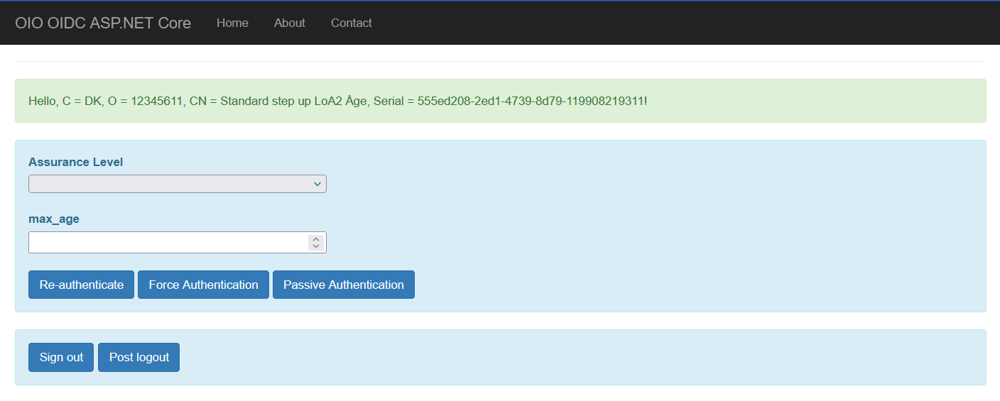

# Introduction
This project contains sample code for OAuth2 and OpenID Connect using ASP.NET Core. The application is built for demonstration and testing purposes, particularly within KOMBIT projects.

To build and test this sample, install the [.NET 10 SDK](https://dotnet.microsoft.com/en-us/download/dotnet/10.0). To run a framework-dependent published application, install the ASP.NET Core Runtime 10; for IIS, install the .NET 10 Hosting Bundle from the same download page. Use an IDE version that supports .NET 10.

By default, all the necessary configurations for running this application are already set up for one-click execution in Visual Studio. These configurations are placed in the "appsettings.json" file. This application supports the following features:

- Uses the Authorization Code Flow with PKCE for user authentication.

- Supports sending an authorization request with a desired assurance level and a specified max_age.

- Supports sending an authorization request to re-authenticate the user, perform passive authentication, or force authentication.

- Session management.

- Supports sending a logout request using POST or GET method.

- Supports sending an authorization request using POST or GET method.

- Supports sending a token request using a specified client authentication method like "client_secret_post", "client_secret_basic", or "private_key_jwt".

- Supports back-channel logout. The URL is at /back-channel-logout

- Supports front-channel logout. The URL is at /front-channel-logout

- Supports ID token encryption.

- Supports the OAuth building blocks that Identify uses for FAPI 2.0: pushed authorization requests (PAR), DPoP-bound access tokens, DPoP binding of the authorization code, the RFC 9207 `iss` check, and configurable client assertions. See [OAuth building blocks and FAPI 2.0](#oauth-building-blocks-and-fapi-20).

- Supports refresh and UserInfo calls from the home page, with a protocol trace, and fault injection for negative tests.

# Configurations

## Enable OpenID Connect session management

### Client configuration
- Edit "appsettings.json" and change the setting EnableSessionManagement to "True"

### Provisioning data
- When the EnableSessionManagement is set to "True", the /Account/ReauthenticationCallback endpoint should be added to the OIDCMetadata's redirect_uris.

## Enable post logout request
Even though an RP-initiated logout request must be made via GET, the implementation has been extended to also accept POST logout requests to support larger logout payloads. 

### Client configuration
- Edit "appsettings.json" and change the setting EnablePostLogout to "True". This option will enable the "PostLogout" button as shown in the following image:


### Provisioning data

For both GET and POST logout requests, the /Account/SignedOutCallback endpoint should be set to OIDCMetadata's post_logout_redirect_uri.

## Support both GET and POST for Authorize request

- Edit "appsettings.json" and change the setting AuthorizationEndpointMethod to "GET" or "POST"

The sign-in buttons post a form with an antiforgery token to /Account/SignIn, so that a cross-site request cannot start a sign-in.

## Support configurable Token Authentication method

- Edit "appsettings.json" and change the setting TokenAuthnMethod to "client_secret_post", "client_secret_basic", "private_key_jwt", or "none" (a public client: only client_id). 

The same method applies at the PAR endpoint.

## Private Key JWT client authentication
- When using "private_key_jwt", you must provide the jwks or jwks_uri for the Identify OAuth/OIDC connection.
- You also need to provide the certificate to sign the client_assertion by configuring these two settings in "appsettings.json":
  - JwtAssertionSigningCertPath
  - JwtAssertionSigningCertPassword
- The `kid` of the client assertion is the base64url SHA-1 hash of the certificate. The key in the jwks must have the same `kid`.
- `ClientAssertion:Audience` and `ClientAssertion:SigningAlgorithm` set the `aud` and `alg` of the assertion. See [settings](#settings).

## ID token encryption

To enable ID token encryption, you need to configure the following settings in "appsettings.json":
- IdTokenDecryptionCertPath
- IdTokenDecryptionCertPassword

This certificate is used to decrypt the encrypted ID token received from the Identity provider.

Note that Identify OAuth server encrypts the ID token by using the public key (use="enc") from the jwks or jwks_uri configured in the Identify OAuth/OIDC connection.
So the jwks or jwks_uri must contain the public certificate in a key (use="enc") which corresponds to the above configured ID token decryption certificate.

## Back-channel & Front-channel logout

When enabling back-channel or front-channel logout on the Identify's OIDC connection, you must disable the EnableSessionManagement by setting it to "false".

# OAuth building blocks and FAPI 2.0

Identify implements section 5 of the [FAPI 2.0 Security Profile](https://openid.net/specs/fapi-security-profile-2_0-final.html#section-5) as independent building blocks, not as a FAPI profile. This sample follows the same approach. Each block has its own setting, or it is always available. No setting turns on another setting, and no code checks for "FAPI". You combine the blocks to match the Identify connection that you test.

The Identify documents are in the Identify repository, in `docs/features/US38464/`. The configuration guide `fapi2-configuration-guide.md` describes the Identify connection for FAPI 2.0. The plan for this sample is [webappnetcore-fapi2-plan.md](../../../../docs/features/US38464/webappnetcore-fapi2-plan.md).

## Settings

All keys are in the `OpenIdConnectOptions` section, except the last one. The defaults keep the earlier behavior. An invalid value stops the application at startup, so that a misspelled value never reads as "off".

| Setting | Values, default | Standard | Behavior |
|---|---|---|---|
| `PushedAuthorization` | `Disable`, `UseIfAvailable`, `Require`; default `Disable` | RFC 9126 | When the request is pushed, the browser gets only `client_id` and `request_uri`. Identify always publishes `require_pushed_authorization_requests=false`, so use `Require` for a connection that requires PAR. |
| `ClientAssertion:Audience` | `TokenEndpoint`, `Issuer`; default `TokenEndpoint` | RFC 7523 | The `aud` of the client assertion at the token and PAR endpoints. `Issuer` sends the discovered issuer as one JSON string, as the Identify rule `clientAssertion.audience=issuer` requires. |
| `ClientAssertion:SigningAlgorithm` | `RS256` to `PS512`; default `RS256` | FAPI 5.4.1 | The `alg` of the client assertion. |
| `DPoP:BindAccessTokens` | `true`, `false`; default `false` | RFC 9449 section 5 | Every token request (code and refresh) carries a DPoP proof. A token response with a `token_type` other than `DPoP` fails. |
| `DPoP:SendDPoPJkt` | `true`, `false`; default `false` | RFC 9449 section 10 | The authorization request, pushed or direct, carries `dpop_jkt`, so Identify binds the code to the key. |
| `DPoP:SendProofToParEndpoint` | `true`, `false`; default `false` | RFC 9449 section 10.1 | The PAR request carries a DPoP proof, so Identify binds the code to the key. No effect on a direct request. |
| `DPoP:SigningAlgorithm` | `RS256` to `PS512`; default `PS256` | FAPI 5.4.1 | The `alg` of DPoP proofs. |
| `ValidIdTokenSigningAlgorithms` | comma list; empty keeps the library default | FAPI 5.4.1 | The allowed algorithms of the ID token signature. |
| `Testing:EnableFaultInjection` | `true`, `false`; default `false` | None | Shows the fault lists of [fault injection](#fault-injection). Never `true` for a production client. |
| `Testing:OtherClientId` | a client ID; no default | None | The client ID of another client, for the faults `RedeemAsOtherClient`, `RefreshAsOtherClient`, `AssertionIssuerNotClient`, and `ClientIdNotSubject`. Without a value, these faults fail with a message. |

These capabilities have no setting:

- The token, PAR, and UserInfo endpoints come from the discovery document. The discovered `issuer` must equal `ClaimsIssuer`.
- A present `iss` in the authorization response must equal the discovered issuer. When discovery has `authorization_response_iss_parameter_supported=true`, a missing `iss` fails (RFC 9207).
- The nonce has 43 characters (FAPI 2.0 allows at most 64), and the ID token nonce is checked against the nonce cookie of the browser.
- Each sign-in gets a new RSA 2048 DPoP key. All proofs of the sign-in use it: PAR, token, refresh, and UserInfo.
- UserInfo uses the DPoP scheme and a proof with `ath` for a DPoP-bound access token, and the Bearer scheme otherwise.
- After a DPoP nonce challenge (`use_dpop_nonce`), the sample retries once with the nonce (RFC 9449 sections 8 and 9). It keeps the latest `DPoP-Nonce` of each server, also from a successful response, and puts it in the next proofs to that server: one nonce for the PAR and token endpoints, another for UserInfo. Identify does not send nonces, so only the unit tests cover this.
- Refresh keeps the old refresh token when the response has none, and stores a returned replacement.

## Example: the FAPI 2.0 combination

```json
"OpenIdConnectOptions": {
  "TokenAuthnMethod": "private_key_jwt",
  "ResponseType": "code",
  "Scope": "openid",
  "EnableSessionManagement": "false",
  "PushedAuthorization": "Require",
  "ClientAssertion": { "Audience": "Issuer", "SigningAlgorithm": "PS256" },
  "DPoP": { "BindAccessTokens": true, "SendDPoPJkt": true, "SendProofToParEndpoint": false, "SigningAlgorithm": "PS256" },
  "ValidIdTokenSigningAlgorithms": "PS256"
}
```

Keep the certificate passwords out of `appsettings.json`, for example with user secrets:

```bash
dotnet user-secrets set "OpenIdConnectOptions:JwtAssertionSigningCertPath" "C:\certs\client.pfx"
```

```bash
dotnet user-secrets set "OpenIdConnectOptions:JwtAssertionSigningCertPassword" "<password>"
```

## Identify connection

Configure the OAuth connection as steps 1 to 4 of the Identify configuration guide describe. In short:

1. System Setup, OAuth `additionalRules`: `{"authorize": {"includeIssuerInResponse": true}}`.
2. Connection: `RequirePushedAuthorizationRequests=true` and `RequireDPoPBoundAccessTokens=true`.
3. Connection: the code flow only, `TokenEndpointAuthenticationMethod=PrivateKeyJwt`, `IdTokenSigningAlgorithm=PS256`, `IssueNewRefreshTokenForEveryTokenExchange=false`, and `AllowRefreshToken=true` if you want to test refresh.
4. Connection `AdditionalValidationRules`: PKCE with S256, an HTTPS redirect URI, the code and PAR lifetimes, `clientAssertion.audience=issuer`, and `clientJwt` with `PS256`.

The client keys:

- `ClientJwks` contains the public key of the assertion certificate with `use=sig` and the `kid` that the sample computes (see [Private Key JWT client authentication](#private-key-jwt-client-authentication)). Leave out `alg`, or set it to the value of `ClientAssertion:SigningAlgorithm`, because Identify uses the JWK `alg` as a constraint.
- The DPoP key is not registered. Each sign-in creates a new one.

The redirect URI is `https://<host>:<port>/signin-oidc`. It must use HTTPS, because the guide sets `AllowHttpRedirect=false`.

## Combinations that cannot succeed

The sample sends what the settings say, so that you can see the Identify response. The startup log and the home page warn about the combinations that the sample can detect alone.

| Sample settings | Identify connection | Result |
|---|---|---|
| `SendDPoPJkt=true`, `BindAccessTokens=false` | Any | The code is bound to the key, and the redemption has no proof, so it fails. |
| `PushedAuthorization=Disable` | `RequirePushedAuthorizationRequests=true` | `invalid_request` at the authorization endpoint. |
| `ClientAssertion:Audience=TokenEndpoint` | `clientAssertion.audience=issuer` | `invalid_client` at PAR (401) and at the token endpoint. |
| `ClientAssertion:SigningAlgorithm` not in the rule | `clientJwt.signingAlgorithms` | `invalid_client`. |
| `DPoP:SigningAlgorithm` not in the rule | `clientJwt.signingAlgorithms` | `invalid_dpop_proof`. |
| `BindAccessTokens=false` | `RequireDPoPBoundAccessTokens=true` | `invalid_dpop_proof`. |
| `EnableSessionManagement=true` | `RequirePushedAuthorizationRequests=true` | The session check iframe sends a direct request and gets the Identify error page. |

## The home page

- **OAuth building blocks**: the active settings and the warnings.
- **Access token**: `token_type`, the `cnf.jkt` of the access token, the thumbprint of the DPoP key of the sign-in, and whether they match.
- **Call UserInfo** and **Refresh access token**: a UserInfo call with a fresh proof, and a refresh with the key of the sign-in. The result shows at the top of the page.
- **Pushed authorization request**: the `request_uri` and `expires_in` of the PAR response.
- **Protocol trace**: each request of the sign-in, with the redacted form, the decoded client assertion and DPoP proof, and the response. Client secrets, code verifiers, and JWT signatures are not shown.

The sample keeps the DPoP key and the trace in memory, for one application instance. After a restart, sign in again before you call UserInfo or refresh with DPoP.

## Fault injection

With `Testing:EnableFaultInjection=true`, the sign-in, UserInfo, Refresh, Introspect, Revoke, and client credentials forms get a fault list. A fault is one deliberate protocol violation in the next request of that action. The expected results come from section 5 of the Identify design; "verify" marks a result that the design does not state.

| Fault | Action | Change | Expected Identify result |
|---|---|---|---|
| `SkipPar` | Sign in | A direct authorization request, also when PAR is on | `invalid_request` when the connection requires PAR |
| `ExtraBrowserParameter` | Sign in | `scope` next to `request_uri` in the browser request (GET with PAR only; otherwise the sign-in does not start) | An error response (verify) |
| `AssertionAudienceArray` | Sign in | Client assertion `aud` as a JSON array | `invalid_client` with `clientAssertion.audience=issuer` |
| `AssertionFutureIat` | Sign in | Client assertion `iat` 120 seconds in the future | `invalid_client` when `clientJwt.clockSkewInSeconds` is below 120 |
| `ParProofKeyMismatch` | Sign in | A PAR proof of another key than `dpop_jkt` | `invalid_request` |
| `NoDPoPProof` | Sign in | No proof at the token endpoint | `invalid_dpop_proof` when DPoP is required; an error for a bound code (verify) |
| `WrongDPoPKey` | Sign in | A token proof of a new key | `invalid_grant` for a bound code |
| `WrongHtu` | Sign in | A token proof with the authorization endpoint as `htu` | `invalid_dpop_proof` |
| `SmallDPoPKey` | Sign in | A token proof of an RSA 1024 key | `invalid_dpop_proof` |
| `RedeemCodeTwice` | Sign in | A second redemption after a successful one | `invalid_grant` for the second. Identify then revokes the tokens of the first redemption (RFC 6749 section 4.1.2), so the sign-in stops at UserInfo with `invalid_token`. With a server that does not revoke them, the sign-in continues and the trace shows the second response |
| `BearerAtUserInfo` | Call UserInfo | The Bearer scheme with a DPoP-bound token | HTTP 401 `invalid_token` |
| `MissingAth` | Call UserInfo | A proof without `ath` | HTTP 401 `invalid_dpop_proof` |
| `ReplayDPoPProof` | Call UserInfo | The same proof in two calls | HTTP 401 `invalid_dpop_proof` for the second call |
| `NewDPoPKeyOnRefresh` | Refresh | A new key for the refresh request | Success; the new access token has a new `cnf.jkt` |
| `ParWithoutClientAuthentication` | Sign in | A pushed request with `client_id` and no client authentication | `invalid_client` |
| `ParRedirectUriExtraPath` | Sign in | The pushed `redirect_uri` with an extra path segment `/x` | `invalid_request` (RFC 9700 section 2.1: exact matching) |
| `ParRedirectUriExtraQuery` | Sign in | The pushed `redirect_uri` with an extra query `?x=1` | `invalid_request` |
| `ProofAlgNone` | Sign in | A token proof with `alg` `none` and no signature | `invalid_dpop_proof` |
| `ProofHmac` | Sign in | A token proof with `alg` `HS256`, signed with a random key | `invalid_dpop_proof` |
| `ProofSignatureOtherKey` | Sign in | A token proof with the `jwk` of the DPoP key, signed with another key | `invalid_dpop_proof` |
| `ProofWithoutJti` | Sign in | A token proof without `jti` | `invalid_dpop_proof` |
| `AssertionAlgNone` | Sign in | Client assertions with `alg` `none` and no signature | `invalid_client` at the first endpoint, PAR when it is on |
| `AssertionHmacWithClientSecret` | Sign in | Client assertions with `alg` `HS256`, signed with the client secret (`client_secret_jwt`) | `invalid_client` |
| `AssertionSignedByOtherKey` | Sign in | Client assertions with the `kid` of the client key, signed with a key outside the JWKS | `invalid_client` |
| `AssertionExpired` | Sign in | Client assertions with `exp` 60 seconds and `iat` 120 seconds in the past | `invalid_client` |
| `AssertionWithoutExp` | Sign in | Client assertions without `exp` | `invalid_client` |
| `AssertionIssuerNotClient` | Sign in | Client assertions with `iss` from `Testing:OtherClientId`; `sub` and `client_id` unchanged | `invalid_client` |
| `RedeemAsOtherClient` | Sign in | The token request of the code as `Testing:OtherClientId`, with an assertion signed by the client key. Needs `private_key_jwt` and another connection with the same client keys | `invalid_grant`: the code belongs to another client |
| `MissingCodeVerifier` | Sign in | A token request without `code_verifier` | `invalid_grant` (verify) |
| `TokenRedirectUriMismatch` | Sign in | A token request with `redirect_uri` `/other-callback` on the same origin | `invalid_grant` |
| `UserInfoProofOtherKey` | Call UserInfo | A valid proof of a new key, not the key of the access token | HTTP 401 `invalid_dpop_proof` |
| `UserInfoProofWrongHtm` | Call UserInfo | A proof with `htm` `POST` | HTTP 401 `invalid_dpop_proof` |
| `UserInfoProofWrongHtu` | Call UserInfo | A proof with the token endpoint as `htu` | HTTP 401 `invalid_dpop_proof` |
| `UserInfoProofWrongAth` | Call UserInfo | A proof with the `ath` of another access token value | HTTP 401 `invalid_dpop_proof` |
| `ReplayDPoPProofOnRefresh` | Refresh | Two refresh requests with the same proof; the result is the second | `invalid_dpop_proof` for the second (verify) |
| `RefreshAsOtherClient` | Refresh | The refresh request as `Testing:OtherClientId`, with an assertion signed by the client key. Needs `private_key_jwt` and another connection with the same client keys | `invalid_grant`: the refresh token belongs to another client |
| `ReuseRotatedRefreshToken` | Refresh | A refresh that rotates the refresh token, then a refresh with the old one. The sample keeps the new refresh token. Needs a connection that rotates | `invalid_grant` for the old refresh token |
| `ParMissingCodeChallenge` | Sign in | A pushed request without `code_challenge` | `invalid_request` |
| `ParMissingCodeChallengeMethod` | Sign in | A pushed request without `code_challenge_method` | `invalid_request` |
| `ParPlainPkce` | Sign in | A pushed request with `code_challenge_method` `plain` | `invalid_request` |
| `ParMissingRedirectUri` | Sign in | A pushed request without `redirect_uri` | `invalid_request` |
| `ParRepeatedParameter` | Sign in | A pushed request with `scope` twice | `invalid_request` |
| `ParRequestParameter` | Sign in | A pushed request with a `request` parameter (an unsigned request object) | `invalid_request` |
| `ParNestedRequestUri` | Sign in | A pushed request with a `request_uri` parameter | `invalid_request` |
| `UnknownResponseTypeComponent` | Sign in | A pushed request with `response_type` `code unknown` | `unsupported_response_type` |
| `ResponseTypeWithToken` | Sign in | A pushed request with `response_type` `code token` | An error (verify) |
| `ParProofTokenEndpointHtu` | Sign in | A PAR proof with the token endpoint as `htu`. Needs `DPoP:SendProofToParEndpoint=true` | `invalid_dpop_proof` |
| `ProofWrongHtm` | Sign in | A token proof with `htm` `GET` | `invalid_dpop_proof` |
| `ProofHtuPathCase` | Sign in | A token proof with the `htu` path in upper case | `invalid_dpop_proof` |
| `ProofIatFuture` | Sign in | A token proof with `iat` 120 seconds in the future | `invalid_dpop_proof` |
| `ProofIatOld` | Sign in | A token proof with `iat` 90 seconds in the past | `invalid_dpop_proof` |
| `ProofTypJwt` | Sign in | A token proof with `typ` `JWT` | `invalid_dpop_proof` |
| `ProofPrivateJwkMembers` | Sign in | A token proof whose `jwk` has the private members | `invalid_dpop_proof` |
| `TwoProofs` | Sign in | A token request with two `DPoP` headers | `invalid_dpop_proof` |
| `ProofHtuWithQuery` | Sign in | A token proof with a query in `htu` | Success after normalization |
| `ProofHtuHostUpperCase` | Sign in | A token proof with the `htu` host in upper case | Success after normalization |
| `ProofIatRecent` | Sign in | A token proof with `iat` 30 seconds in the past | Success |
| `ProofNbfFuture` | Sign in | A token proof with `nbf` 120 seconds in the future | `invalid_dpop_proof` with a build that checks `nbf` |
| `WrongDPoPKeyThenRetry` | Sign in | A token request with a new key, then with the key of the sign-in | `invalid_grant`, then success: the wrong key does not consume the code |
| `AssertionWithoutJti` | Sign in | Client assertions without `jti` | `invalid_client` |
| `AssertionAndClientSecret` | Sign in | Client assertions and `client_secret` in the same request | `invalid_client` |
| `ClientIdNotSubject` | Sign in | The form `client_id` from `Testing:OtherClientId`, with an assertion of this client | `invalid_client` |
| `WrongCodeVerifier` | Sign in | A token request with another `code_verifier` | `invalid_grant` |
| `RedeemCodeAfter10Seconds`, `RedeemCodeAfter5Seconds` | Sign in | The sample waits before it redeems the code | `invalid_grant` when the code lifetime is shorter; success otherwise |
| `IntrospectWithClientSecret` | Introspect | The introspection request with `client_secret_post` instead of the configured method | `invalid_client` |
| `NoDPoPProof` | Refresh | No proof in the refresh request | `invalid_dpop_proof` when DPoP is required |
| `ReplayClientAssertion` | Refresh | Two refresh requests with the same client assertion; the result is the second | `invalid_client` for the second |
| `DPoPSchemeForBearerToken` | Call UserInfo | An access token without `cnf.jkt` with the DPoP scheme and a valid proof of a new key. Needs `DPoP:BindAccessTokens=false` | HTTP 401 `invalid_token` |
| `AccessTokenInForm` | Call UserInfo | A POST with the DPoP-bound access token in the `access_token` form parameter and a valid proof, without an `Authorization` header | HTTP 401 `invalid_token` |
| `DPoPSchemeWithoutProof` | Call UserInfo | The DPoP scheme with the DPoP-bound access token and no `DPoP` header | HTTP 401 `invalid_dpop_proof` |
| `RevokeWithClientSecret` | Revoke | The revocation request with `client_secret_post` instead of the configured method | `invalid_client` |
| `PasswordGrant` | Get client credentials token | A token request with `grant_type` `password`, a user name that does not exist, and a random password | `unauthorized_client` when the connection does not allow the password flow |
| `ProofWithoutHtm` | Sign in | A token proof without `htm` | `invalid_dpop_proof` |
| `ProofWithoutHtu` | Sign in | A token proof without `htu` | `invalid_dpop_proof` |
| `ProofWithoutIat` | Sign in | A token proof without `iat` | `invalid_dpop_proof` |
| `ReplayParAssertionAtToken` | Sign in | The token request of the code with the client assertion of the pushed request. Needs `private_key_jwt` and PAR | `invalid_client`: the PAR endpoint used its `jti` |
| `AssertionNbfFuture` | Sign in | Client assertions with `nbf` 120 seconds in the future and `iat` now | `invalid_client` (verify) |
| `UserInfoProofAlgNone` | Call UserInfo | A proof with the `jwk` of the DPoP key, `alg` `none`, and no signature | HTTP 401 `invalid_dpop_proof` |
| `UserInfoProofSignatureOtherKey` | Call UserInfo | A proof with the `jwk` of the DPoP key, signed with another key | HTTP 401 `invalid_dpop_proof` |
| `UserInfoProofWithoutJti` | Call UserInfo | A proof without `jti` | HTTP 401 `invalid_dpop_proof` |
| `UserInfoProofIatOld` | Call UserInfo | A proof with `iat` 90 seconds in the past | HTTP 401 `invalid_dpop_proof` |
| `AccessTokenInQuery` | Call UserInfo | A GET with the DPoP-bound access token in the `access_token` query parameter and a valid proof, without an `Authorization` header. FAPI 2.0 section 5.3.4 forbids access tokens in the query | HTTP 401 `invalid_token`, or HTTP 400 `invalid_request` when UserInfo does not read the query (verify) |
| `IntrospectWithoutClientAuthentication` | Introspect | The introspection request with `client_id` and no client authentication | `invalid_client` |
| `RevokeWithoutClientAuthentication` | Revoke | The revocation request with `client_id` and no client authentication | `invalid_client` |
| `RefreshWithoutClientAuthentication` | Refresh | The refresh request of a confidential client with `client_id` and no client authentication. The refresh token is not bound to the DPoP key, so only client authentication protects it | `invalid_client` |
| `IdTokenAtUserInfo` | Call UserInfo | The ID token of the sign-in with the Bearer scheme instead of the access token: a token substitution | HTTP 401 `invalid_token` (verify) |
| `RefreshWiderScope` | Refresh | A refresh request with the scope of the sign-in and the scope `fapi-fault-not-granted`, which no connection has (RFC 6749 section 6) | `invalid_scope`, or a token without the extra scope (verify) |
| `IntrospectAsOtherClient` | Introspect | The introspection request as `Testing:OtherClientId`, with an assertion signed by the client key. Needs `private_key_jwt` and another connection with the same client keys | An error or `active` `false` (verify) |
| `RevokeAsOtherClient` | Revoke | The revocation request as `Testing:OtherClientId`, with an assertion signed by the client key. Needs `private_key_jwt` and another connection with the same client keys | The access token stays valid; an error (verify, RFC 7009 section 2.1) |
| `ExtraBrowserRedirectUri` | Sign in | `redirect_uri` `/fault-redirect` on the origin of the sample next to `request_uri` in the browser request (GET with PAR only) | The code goes to the pushed redirect URI, or an error; never to `/fault-redirect` |
| `BrowserWithoutClientId` | Sign in | Only `request_uri` in the browser request, without `client_id` (GET with PAR only) | `invalid_request` (verify, RFC 9126 section 4) |
| `AssertionHeaderJwk` | Sign in | Client assertions signed with a new key, without `kid`, and with the new key as `jwk` in the header | `invalid_client` |
| `AssertionHeaderX5c` | Sign in | Client assertions signed with a new key, without `kid`, and with a self-signed certificate of the new key as `x5c` in the header | `invalid_client` |
| `AssertionHeaderJku` | Sign in | Client assertions signed with a new key, without `kid`, and with a `jku` URL of a host that does not exist in the header | `invalid_client` |

Signed in, the home page also has **Introspect access token** (RFC 7662) and **Revoke access token** (RFC 7009), with the configured client authentication. **Get client credentials token** (RFC 6749 section 4.4) needs no sign-in: with `DPoP:BindAccessTokens=true` the request has a proof of a new key, and the result says whether the token is bound to it.

## FAPI 2.0 client requirements

| FAPI item | Setting or capability |
|---|---|
| 5.3.3.1-1 sender binding | `DPoP:BindAccessTokens=true`; the faults `WrongDPoPKey` and `BearerAtUserInfo` show the rejection |
| 5.3.3.1-2 client authentication | `TokenAuthnMethod=private_key_jwt`; the certificate password in user secrets |
| 5.3.3.1-3 token transport | UserInfo with `Authorization: DPoP` |
| 5.3.3.1-4 redirect safety | The application redirects only to local paths |
| 5.3.3.1-5 assertion audience | `ClientAssertion:Audience=Issuer` |
| 5.3.3.1-6 refresh | **Refresh access token**; replacement storage |
| 5.3.3.1-7 mTLS aliases | Not applicable; the sample uses DPoP |
| 5.3.3.1-8 DPoP nonce | Always supported; unit tests only |
| 5.3.3.1-9 metadata | Endpoints from discovery |
| 5.3.3.1-10 trusted issuer | `ClaimsIssuer` in the application configuration |
| 5.3.3.1-11 issuer consistency | The discovered issuer must equal `ClaimsIssuer` |
| 5.3.3.1-12 initiation protection | POST sign-in with an antiforgery token; the correlation cookie binds the flow to the browser |
| 5.3.3.1-13 least privileges | `Scope=openid` |
| 5.3.3.2-1 code grant | `ResponseType=code` |
| 5.3.3.2-2 PAR | `PushedAuthorization=Require` |
| 5.3.3.2-3 S256 | Always |
| 5.3.3.2-4 fresh bound challenge | Always; a new verifier for each flow, protected in `state` |
| 5.3.3.2-5 response issuer | Always; the RFC 9207 check |
| 5.3.3.2-6 browser parameters | `PushedAuthorization=Require`; only `client_id` and `request_uri` |
| 5.3.3.2-7 nonce length | Always; 43 characters |
| 5.4.1 algorithms | `ClientAssertion:SigningAlgorithm=PS256`, `DPoP:SigningAlgorithm=PS256`, `ValidIdTokenSigningAlgorithms=PS256`; RSA 2048 keys |

## Limitations

- The DPoP key and the trace are in memory, for one application instance.
- Identify does not support the DPoP server nonce, ES256, EdDSA, or request objects inside PAR, so the sample does not use them. The nonce retry is covered by unit tests only.
- The sample does not use mTLS, and it has no resource server of its own. Identify UserInfo is the DPoP-protected resource.
- OIDC session management does not work together with a connection that requires PAR.
